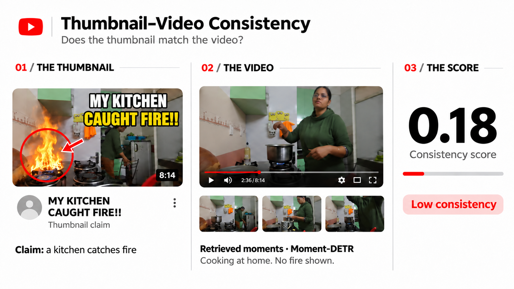
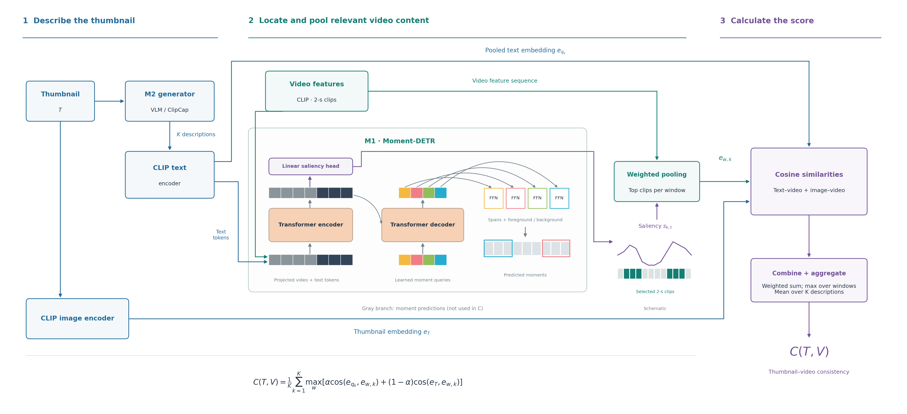

# Thumbnail–Video Consistency



> **Question this project answers:** *Does this thumbnail really show what happens in the video?*
>
> We give the system a **thumbnail image** and a **video**. It returns a **score**.
> High score = the thumbnail matches the video. Low score = the thumbnail is misleading (clickbait).
---

## Contents

1. [The idea](#1-the-idea)
2. [How the pipeline works](#2-how-the-pipeline-works)
3. [Project folders and files](#3-project-folders-and-files)
4. [Setup (first time only)](#4-setup-first-time-only)
5. [How to run it](#5-how-to-run-it)
6. [Ready example to try](#6-ready-example-to-try)
7. [How the system is evaluated](#7-how-the-system-is-evaluated)
8. [Common problems](#8-common-problems)

---

## 1. The idea

A thumbnail is a promise: "this is what you will see". To check that promise we:

1. **Describe the thumbnail in words.** A model looks at the image and writes short sentences
   ("queries"), for example *"a man shows places to visit in Istanbul"*. This is **M2**.
2. **Search the video for that description.** A video model (**Moment-DETR**, called **M1**)
   finds *which seconds of the video* match the sentence.
3. **Compare.** We check how similar the thumbnail and the sentence are to those found moments.
   If the video really contains what the thumbnail shows, the similarity is high.

All the comparing is done with **CLIP**, a model that turns images and text into vectors
(lists of numbers). Similar things get similar vectors.

---

## 2. How the pipeline works



How to read the diagram:

1. **Describe the thumbnail.** The M2 generator (VLM or ClipCap) writes K descriptions. CLIP turns them
   into a pooled text embedding `e_qk` (one per description) and into text tokens for Moment-DETR.
   The thumbnail itself goes through the CLIP image encoder to get `e_T`.
   (The `gt` and `random` generators are baselines and plug into the same M2 slot.)
2. **Find and pool the relevant video content.** Moment-DETR (M1) reads the video features
   (CLIP, one per 2-second clip) together with the text tokens. Its saliency head gives a score
   `s_k,t` for every clip. We keep the top clips in each window and average them, weighted by saliency,
   to get `e_w,k`. The moment spans that Moment-DETR predicts (gray branch) are shown in the output
   but are **not used** in the score.
3. **Calculate the score.** Cosine similarity text–video and thumbnail–video, weighted sum with `alpha`,
   max over windows, mean over the K descriptions → `C(T, V)`.

**The formula** (in `src/scoring.py`):

```
C = average over queries of  max over video windows of
        [ alpha · cos(query, window) + (1 − alpha) · cos(thumbnail, window) ]
```

| Setting (in `config.yaml`) | Meaning | Default |
|---|---|---|
| `alpha` | How much the **query** matters vs. the **thumbnail image** itself | 0.5 |
| `tau` | How "sharp" the focus on the most relevant clips is (smaller = sharper) | 0.1 |
| `top_p` | Fraction of clips kept when averaging (most relevant first) | 0.25 |
| `chunk_window` / `chunk_stride` | Long videos are cut into 150 s windows (Moment-DETR limit is 75 clips) | 75 / 60 |

### The M2 generators (who writes the queries)

| Name | What it does | Needs GPU? |
|---|---|---|
| `gt` | Uses the real human-written QVHighlights query. **Best possible case (upper bound).** | No |
| `random` | Picks a random query. **Control: should score badly (AUC ≈ 0.5).** | No |
| `vlm` | A vision-language model (Qwen2-VL-2B, 4-bit) describes the image. | Yes |
| `clipcap` | Our own small trained model: CLIP + a small MLP + GPT-2. **The only part we train.** | Yes (training) |

You can also skip M2 completely and type your own queries with `--queries`.

---

## 3. Project folders and files

```
thumbnail-consistency/
├── README.md            ← this document (how the system works, how to run it)
├── config.yaml          ← THE single settings file (paths, scoring, models, app)
├── requirements.txt     ← Python packages
├── src/                 ← all the real logic
│   ├── cli.py           ← command-line tool: check / generate / score / evaluate / train-clipcap
│   ├── config.py        ← reads config.yaml, resolves file paths (also fixes old Colab paths)
│   ├── scoring.py       ← ★ the score formula + ConsistencyScorer (the heart of the project)
│   ├── moment_detr.py   ← wrapper around Moment-DETR (M1)
│   ├── encoders.py      ← CLIP image/text encoders (loaded once, cached)
│   ├── metrics.py       ← AUC, Cohen's d, Welch t-test
│   └── generators/      ← M2 generators
│       ├── __init__.py  ← registry: build("gt"), available()
│       ├── baselines.py ← gt and random
│       ├── vlm.py       ← Qwen2-VL (any Hugging Face vision-language model)
│       └── clipcap.py   ← ClipCap model + its training loop
├── app/                 ← small website (Flask) around the same pipeline
│   ├── server.py        ← routes: /, /health, /v1/generators, /v1/score
│   ├── templates/       ← HTML page
│   └── static/          ← CSS
├── tests/               ← pytest tests
├── notebooks/
│   └── data_prep_colab.ipynb  ← how the data in data/ was built (run on Colab)
├── assets/            ← README banner image
├── pipeline_image/      ← pipeline diagram (README uses thumbnail_consistency_pipeline_vf.png)
├── data/                ← data (big files are NOT in git, see below)
│   └── processed/       ← JSONL files: train/val/test + the 3 evaluation sets (in git)
├── Moment_DETR/         ← upstream Moment-DETR code + checkpoint (NOT in git, you clone it)
├── outputs/             ← results written by the tools (NOT in git)
└── checkpoints/         ← trained ClipCap weights (NOT in git)
```

**Rule:** logic lives in `src/`. The CLI and the app only call `src/`.

**What is NOT pushed to GitHub** (too big, see `.gitignore`): `.venv/`, `Moment_DETR/`,
`data/features/`, `data/qvh_frames*/`, `data/qvh_thumbnails/`, `*.tar.gz`, `*.pt`, `*.ckpt`,
`outputs/`, `checkpoints/`.

---

## 4. Setup (first time only)

Commands are for **Windows PowerShell**, run from the project folder.

**Step 1 — Python environment**

```powershell
python -m venv .venv
.\.venv\Scripts\activate
# Install PyTorch first (pick the CUDA version of your GPU from pytorch.org), for example:
pip install torch torchvision --index-url https://download.pytorch.org/whl/cu121
pip install -r requirements.txt
```

**Step 2 — Moment-DETR (M1) code + checkpoint**

```powershell
git clone https://github.com/jayleicn/moment_detr Moment_DETR/moment_detr
```

The checkpoint is already inside it at
`Moment_DETR/moment_detr/run_on_video/moment_detr_ckpt/model_best.ckpt`.

**Step 3 — Data**

- **Video features:** the official QVHighlights CLIP features (`moment_detr_features.tar.gz`)
  extracted so the `.npz` files are in `data/features/clip_features/`.
- **Frames / thumbnails:** `data/qvh_frames/`, `data/qvh_frames_within_neg/`, `data/qvh_thumbnails/`,
  made by `notebooks/data_prep_colab.ipynb` (keep them on Google Drive, copy them here).
- Want the data in another folder? Set `$env:THUMB_DATA_DIR = "D:\path\to\data"`.

**Step 4 — Check everything**

```powershell
python -m src.cli check        # lists every package / file as [ok] or [MISSING]
python -m pytest tests -q      # run the tests
```

---

## 5. How to run it

Put these two lines first in every new PowerShell window (offline mode = don't try to download models;
utf-8 = no text-printing errors):

```powershell
$env:HF_HUB_OFFLINE = "1"; $env:PYTHONIOENCODING = "utf-8"
```

### A. Command line (`python -m src.cli ...`)

| Command | What it does |
|---|---|
| `python -m src.cli check` | Show what is installed and what is missing |
| `python -m src.cli generate --image IMG --gen vlm -k 3` | Only M2: thumbnail → queries |
| `python -m src.cli score --image IMG --vid VID --gen gt --qid QID` | Full score using the real query |
| `python -m src.cli score --image IMG --vid VID --queries "your sentence"` | Full score with your own sentence |
| `python -m src.cli evaluate --set easy --gen gt random --limit 100` | AUC on an evaluation set |
| `python -m src.cli train-clipcap --epochs 20` | Train ClipCap (saves to `checkpoints/clipcap_best.pt`) |

- `VID` is a QVHighlights video id like `QriapOfdU64_60.0_210.0` (its `.npz` must exist in the features folder).
- `--set` can be `easy`, `hard`, `query_mismatch`, or a path to your own JSONL.
- `--output result.json` saves the score result to a file.

**What the score output means:**

| Field | Meaning |
|---|---|
| `C` | **The final consistency score.** Higher = more consistent. |
| `per_query` | Score for each query (C is their average) |
| `max_fg_prob` | How confident Moment-DETR is that it found a matching moment (0–1) |
| `top_moments` | `[start_sec, end_sec, confidence]` of the best moment per query |
| `thumb_video_max_cos` | Best direct similarity between the thumbnail and any video clip |

### B. Website (Flask app)

```powershell
python -m app --port 5050
# open http://127.0.0.1:5050 in the browser
```

Upload a thumbnail, write the video id, choose a generator (or type queries) → get the score
and a verdict (`consistent` if score ≥ `app.threshold` in `config.yaml`).

API for other programs:

- `GET /health` → which models/files were found
- `GET /v1/generators` → list of generators
- `POST /v1/score` → JSON `{"thumbnail_path", "vid", "gen", "k", "qid", "queries"}` or a form upload with a `thumbnail` file

---

## 6. Ready example to try

From `consistency_eval_hard.jsonl`: video `QriapOfdU64_60.0_210.0`, query id `5399`:
*"The man in the black, white and yellow t-shirt is showing places to be visited in Istanbul, Turkey"*.

```powershell
$env:HF_HUB_OFFLINE = "1"; $env:PYTHONIOENCODING = "utf-8"

# 1) Correct thumbnail + correct query  -> expect a HIGHER C
python -m src.cli score --image data\qvh_frames\QriapOfdU64_60.0_210.0.jpg --vid QriapOfdU64_60.0_210.0 --gen gt --qid 5399 -k 1

# 2) Same thumbnail, unrelated query  -> expect a LOWER C
python -m src.cli score --image data\qvh_frames\QriapOfdU64_60.0_210.0.jpg --vid QriapOfdU64_60.0_210.0 --queries "A woman cooks pasta in a kitchen."

# 3) Thumbnail from outside the matching moment (hard negative)  -> expect a slightly LOWER C
python -m src.cli score --image data\qvh_frames_within_neg\QriapOfdU64_60.0_210.0_clip0.jpg --vid QriapOfdU64_60.0_210.0 --gen gt --qid 5399 -k 1

# 4) Small evaluation (fast, no GPU model needed)
python -m src.cli evaluate --set easy --gen gt random --limit 100
```

---

## 7. How the system is evaluated

There are **3 test sets** in `data/processed/` (more details in `data/processed/README.md`).
Each has 300 good pairs (label 1) and about 300 bad pairs (label 0):

| Set | How the bad pairs are made | What it tests |
|---|---|---|
| `easy` (`consistency_eval.jsonl`) | Thumbnail from video A, scored against a different video B | Can it tell different videos apart? |
| `hard` (`consistency_eval_hard.jsonl`) | Same video, but a frame from **outside** the matching moment | Can it find the **right moment**? |
| `query_mismatch` | Same thumbnail and video, but a query about another topic | Does it really **use the query**? |

**Metrics:** **AUC** (0.5 = random guessing, 1.0 = perfect) and **Cohen's d** (how far apart the
good and bad scores are; above 0.8 is a big difference).

---

## 8. Common problems

| Problem | Reason | Fix |
|---|---|---|
| `check` shows `Moment-DETR code MISSING` | `Moment_DETR/` not cloned | Do Setup step 2 |
| `video features MISSING` / `FileNotFoundError ... .npz` | Features not extracted, or wrong `--vid` | Extract into `data/features/clip_features/`; check the vid name |
| `generator 'gt' requires qid` | `gt` needs the query id | Add `--qid` |
| `unknown generator` | Name is wrong | Use `gt`, `random`, `vlm`, or `clipcap` |
| Model tries to download / hangs | Not offline | `$env:HF_HUB_OFFLINE = "1"` (only after the model is downloaded once) |
| `UnicodeEncodeError` when printing | Windows console encoding | `$env:PYTHONIOENCODING = "utf-8"` |
| CUDA out of memory | GPU too small | Use the 2B VLM in 4-bit, smaller `-k`, close other programs |
| Process killed / PC freezes | Not enough RAM | Run one heavy job at a time |

**Tips for a 4 GB GPU / low-RAM PC:** close other programs, run one heavy job at a time,
use `--limit` in `evaluate`, and keep `load_in_4bit: true` for the VLM.
